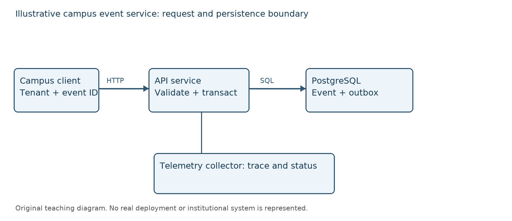
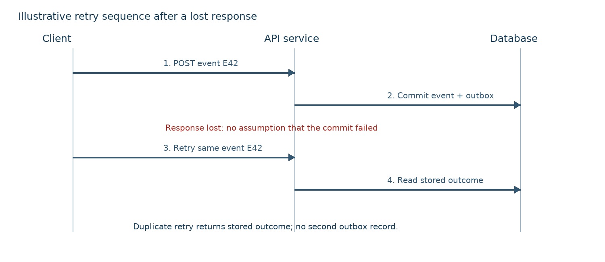
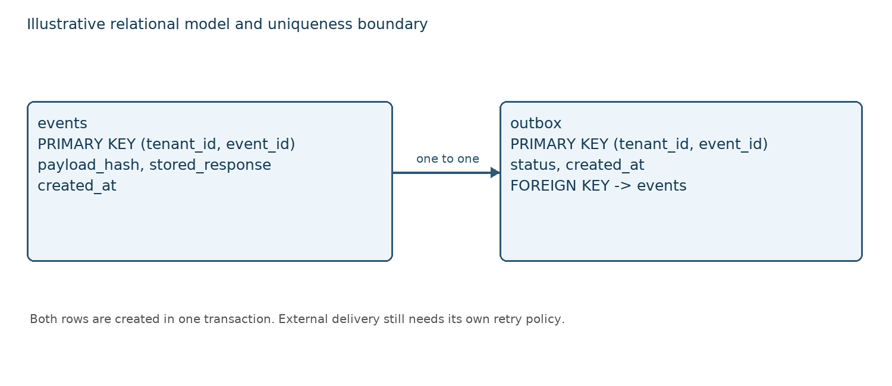
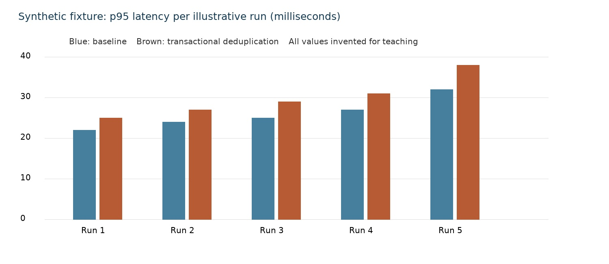

# Results and Analysis


The example artifact placed identity checking and outbox insertion within one persistence boundary. The contribution was illustrated through an evidence matrix that distinguished duplicate suppression, conflict handling, atomicity and diagnostic visibility.

The chapter followed design, implementation and evaluation in that order. Figures represented the proposed system, code illustrated selected boundaries, and tables reported invented observations whose arithmetic could be inspected independently.

## Architecture and Persistence Boundary


Figure 1 showed the client, API service, database and telemetry collector. The collector was drawn outside the transaction boundary because diagnostic export was not part of the event/outbox commit.

The service associated a stored result with each accepted tenant/event pair. A successful replay returned that stored outcome, while an attempt to reuse the identity for different content entered the conflict path.



The diagram made the database the decision point for durable identity. It deliberately omitted remote delivery acknowledgment, whose guarantees were not evaluated in this example.



Figure 2 followed a commit whose response was lost. The second request was a replay of the same logical event, so an absent first response did not justify a second outbox record.



Figure 3 expressed a one-to-one event/outbox relationship inside the selected transaction. It did not imply that any external consumer shared this transaction.

## Implementation and Conflict Handling


Listing 1 expressed the control flow using an abstract transaction adapter. The adapter was assumed to enforce uniqueness and atomic event/outbox creation; the listing was pseudocode and was not an executable implementation of database concurrency.

A digest compared the canonical payload with the stored content identity. A production implementation would specify canonicalization, bounded key retention, transaction isolation and handling of concurrent insertion conflicts; those details could not be inferred from the short extract alone.

```python caption="Transaction-adapter pseudocode for event acceptance." source="assets/accept_event.py"
def accept_event(tx, tenant_id, event_id, digest, payload):
    # Pseudocode: the adapter must handle concurrent unique conflicts.
    with tx.atomic():
        previous = tx.find_event(tenant_id, event_id)
        if previous is not None:
            if previous.digest != digest:
                return {"status": 409, "outcome": "conflict"}
            return previous.response
        response = {"status": 201, "event_id": event_id}
        tx.insert_event(tenant_id, event_id, digest, response)
        tx.insert_outbox(tenant_id, event_id, payload)
        return response
```

The extract separated replay from payload conflict. Its correctness depended on the adapter contract and would require concurrent and rollback testing in a real implementation.

The SQL extract below showed the identity constraint for the event table. Appendix B supplied related payload and configuration examples.

```sql caption="Illustrative non-null event identity constraint."
CREATE TABLE events (
    tenant_id text NOT NULL,
    event_id text NOT NULL,
    payload_hash text NOT NULL,
    stored_response jsonb NOT NULL,
    PRIMARY KEY (tenant_id, event_id)
);
```

The compound key made identity tenant-specific. The outbox foreign key and its unique event association were separate schema requirements described by Figure 3, not silently supplied by this short table definition.

## Correctness Results and Failure Cases


The correctness fixture assigned 1,000 unique event identities and 200 repeated valid requests to each variant. Simple insertion was assigned 1,200 event rows and 1,200 outbox rows, while the protected variant was assigned 1,000 of each.

The 200 excess baseline rows represented duplicate persistence within the constructed fixture. Table 3 showed the arithmetic and did not establish that either variant had been run. Separate conflict, rollback and concurrent-retry cases were retained as example test specifications in Appendix A.

Table: Synthetic correctness fixture; no tests were executed. {widths="3,1,1"}
| Observation | Baseline | Protected |
|---|---|---|
| Unique valid identities | 1000 | 1000 |
| Valid requests including retries | 1200 | 1200 |
| Event rows | 1200 | 1000 |
| Outbox rows | 1200 | 1000 |
| Excess rows per table | 200 | 0 |

The fixture supported a teaching comparison of the intended invariants. It did not show resilience under crashes, isolation anomalies or remote-consumer retries, which remained specification cases rather than observed successes.

## Latency Analysis and Mathematical Model


Five synthetic paired summaries represented run-level p95 latency at the same illustrative arrival rate. Baseline values were 22, 24, 25, 27 and 32 milliseconds; protected values were 25, 27, 29, 31 and 38 milliseconds, as retained in the CSV attachment.

For variant $v$, $L_{v,i}$ denoted the p95 latency in run $i$, measured in milliseconds, and $n=5$ denoted the number of runs. Equation 1 defined the mean of those run-level summaries; it was not the percentile of all requests pooled together.

$$
\bar{L}_v = \frac{1}{n}\sum_{i=1}^{n} L_{v,i}
$$

The mean was 26 milliseconds for the baseline and 30 milliseconds for the protected fixture. Equation 2 expressed their relative difference, where $\Delta_L$ was dimensionless before multiplication by 100.

$$
\Delta_L = \frac{\bar{L}_{\mathrm{protected}}-\bar{L}_{\mathrm{baseline}}}{\bar{L}_{\mathrm{baseline}}}\times100\% = \frac{30-26}{26}\times100\% \approx 15.4\%
$$

Figure 4 displayed the same five pairs rather than a different dataset. The visibly larger protected values illustrated a possible cost of additional persistence work, without establishing a causal effect in real systems.



The mean paired difference was 4 milliseconds. With no measured request distribution, the example did not report confidence intervals, significance tests or a claim about a production latency objective.

## Diagnostic Evidence and Requirement Traceability


The illustrative trace used one event identity across an initial acceptance and a replay. The status fields described the service’s decision, while the durable record count remained the required persistence check.

The trace below was hand-authored teaching material. It demonstrated a readable log listing, not proof that instrumentation had observed the example transaction.

```text caption="Synthetic status trace for a lost-response replay."
2026-10-27T10:00:00Z tenant=t1 event=E42 outcome=accepted
2026-10-27T10:00:01Z tenant=t1 event=E42 outcome=replayed
2026-10-27T10:00:02Z tenant=t1 event=E42 outcome=conflict
```

Table: Evidence matrix and explicit claim boundary. {widths="1,2,2,2"}
| Criterion | Evidence type | Fixture outcome | Established empirically |
|---|---|---|---|
| R1 / RQ1 | Table 3 arithmetic | Zero protected excess rows | No; synthetic |
| R2 | Conflict test specification | Reject changed digest | No; not executed |
| R3 | Transaction design | Atomic event/outbox intent | No; not executed |
| R4 / RQ2 | Hand-authored trace | Status categories visible | No; synthetic |
| R5 / RQ2 | Five CSV pairs | Mean difference 4 ms | No; synthetic |

The matrix prevented specification coverage from being mistaken for successful execution. A real study would replace the final column with auditable outcomes and links to raw evidence.

## Analysis of Tradeoffs and Unresolved Behavior


The constructed comparison illustrated why lower duplicate persistence could be evaluated alongside higher latency rather than collapsed into a single success label. It also showed why a replay response and an atomic database outcome were different observations.

Concurrent requests, retention expiry and downstream redelivery remained unresolved in the evidence. The pseudocode’s lookup-then-insert shape particularly required a real adapter to resolve unique-key races; no conclusion of concurrency safety followed from the diagram or the synthetic table.

